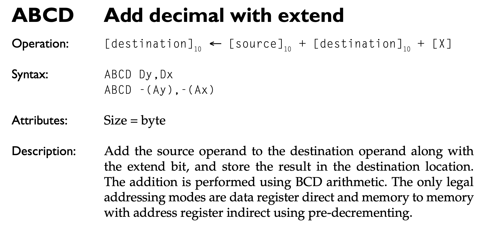

# Instruction Handlers

Each instruction is emulated by an instruction handler. As explained in [The Main Execution Function](/guides/concepts/MainExecutionFunction), Moira looks up the handler of the next opcode in a jump table and calls it through a function pointer. This article explains how a handler is structured and how the jump table is built.

As an example, we look at the ABCD instruction, which adds two binary-coded decimal numbers:



The following handler implements the register variant of the instruction:

```c++
template <Core C, Instr I, Mode M, Size S> void
Moira::execAbcdRg(u16 opcode)
{
    AVAILABILITY(Core::C68000)

    int src = _____________xxx(opcode);
    int dst = ____xxx_________(opcode);

    u32 result = bcd<C, I, Byte>(readD<Byte>(src), readD<Byte>(dst));

    prefetchLate<C, POLL>();
    SYNC(2);
    writeD<Byte>(dst, result);

    //           00  10  20        00  10  20        00  10  20
    //           .b  .b  .b        .w  .w  .w        .l  .l  .l
    CYCLES_DN   ( 6,  6,  4,        0,  0,  0,        0,  0,  0)

    FINALIZE
}
```

## Template Parameters

All instruction handlers are function templates with four parameters:

- `Core C`: The execution core. Moira has three cores: `C68000` for the 68000, `C68010` for the 68010, and `C68020` for the 68020 and all later models.
- `Instr I`: The instruction.
- `Mode M`: The addressing mode.
- `Size S`: The operand size.

For `ABCD Dy,Dx` on a 68000, the parameters are `C68000`, `ABCD`, `DN` and `Byte`.

Because all four parameters are known at compile time, the compiler creates a specialized function for each combination. Code that doesn't apply to a combination, e.g. the timing of another core or the handling of another addressing mode, is removed with `if constexpr`. Many handlers implement several instructions this way. `execAbcdRg`, for example, is also used for SBCD, which differs only in the operation that `bcd<C, I, Byte>` performs.

## Execution Flow

**1. Availability Check**

All instruction handlers begin with the `AVAILABILITY` macro:

```c++
AVAILABILITY(Core::C68000)
```

The argument is the first core that supports the instruction. The macro checks at compile time that the handler is not instantiated for an older core. On the 68020 core, it also resets the cycle penalty of the instruction (see below). Finally, it calls `willExecute()` if the instruction is selected by `MOIRA_WILL_EXECUTE` (see [Using the Delegation System](/guides/howto/HowToUseDelegates)).

**2. Extracting Operands**

The next lines extract the register numbers from the opcode. The name of each macro marks the bits it extracts:

```c++
int src = _____________xxx(opcode);
int dst = ____xxx_________(opcode);
```

**3. Performing the Operation**

The `bcd` function computes the result and sets the condition codes:

```c++
u32 result = bcd<C, I, Byte>(readD<Byte>(src), readD<Byte>(dst));
```

**4. Prefetching the Next Instruction**

The 68000 has a prefetch queue. While an instruction is executed, the CPU already reads the next instruction word from memory. Moira emulates the queue and performs the prefetch at the same point in the instruction as the real CPU:

```c++
prefetchLate<C, POLL>();
SYNC(2);
```

`prefetchLate` reads the next word into the queue and then moves it into the instruction decode register. The `POLL` flag marks this bus cycle as the one in which the CPU samples the interrupt lines (see [The Timing Model](/guides/concepts/TimingModel)). `SYNC(2)` lets two more cycles pass, which the real CPU spends computing the result.

**5. Writing Back the Result**

```c++
writeD<Byte>(dst, result);
```

The order of these steps matters if an exception occurs. If the prefetch causes a bus error, for example, the register still contains its old value, as on the real CPU.

**6. Timing**

```c++
//           00  10  20        00  10  20        00  10  20
//           .b  .b  .b        .w  .w  .w        .l  .l  .l
CYCLES_DN   ( 6,  6,  4,        0,  0,  0,        0,  0,  0)
```

The table contains the number of cycles for each core (68000, 68010, 68020) and operand size. `CYCLES_DN` only applies to the `DN` addressing mode. Similar macros exist for the other modes. What the macro does depends on the core and on `MOIRA_PRECISE_TIMING`:

- On the 68000 and 68010 without precise timing, it expands to `sync(6)`, which reports the cycles of the whole instruction at once.
- On the 68000 and 68010 with precise timing, it expands to nothing. The cycles have already been reported by the memory accesses and the `SYNC` calls in the handler.
- On the 68020 core, it books 4 cycles plus the penalty of the instruction (e.g. for the addressing mode or a cache miss) on the cycle budget.

**7. Finalization**

```c++
FINALIZE
```

The macro calls `didExecute()` if the instruction is selected by `MOIRA_DID_EXECUTE`.

## Building the Jump Table

The jump table has one entry for each of the 65536 opcodes. It is built when the CPU model, the disassembler model or the coprocessor is selected, by a long list of registrations in `MoiraInit_cpp.h`. Each registration describes a group of opcodes with a bit pattern and assigns a handler to it:

```c++
// ABCD Dx,Dy
opcode = parse("1100 ---1 0000 0---");
____XXX______XXX(opcode, Instr::ABCD, Mode::DN, Byte, AbcdRg, CIMS)
```

`parse` turns the pattern into an opcode with all variable bits cleared. The macro `____XXX______XXX` iterates over the variable bits (here, the two register numbers) and registers the handler for each resulting opcode. `CIMS` stores the address of the handler, instantiated for the selected core and the given instruction, mode and size, in the jump table. If the disassembler is enabled, it also registers the corresponding disassembler handler and the instruction information returned by `getInstrInfo()`.

Instructions that can run in the loop mode of the 68010 are registered a second time with `CIMSloop`. This puts a special loop variant of the handler into a second table, `loop`, which is used while the CPU is in loop mode.

## Translation Units

Taking the address of a handler instantiates the template. Since there are three cores, the handlers are instantiated three times, which results in more than 10,000 functions. To keep the memory consumption of the compiler in check, each core is compiled in a translation unit of its own: `MoiraCore68000.cpp`, `MoiraCore68010.cpp` and `MoiraCore68020.cpp` each include the shared implementation (`MoiraCore_cpp.h`) for one core.
