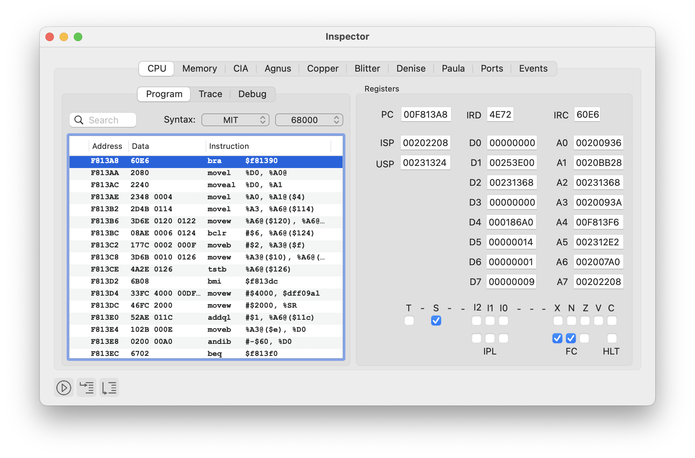

# Using the Disassembler

Moira includes a built-in disassembler. It supports the instruction sets of all emulated models, from the 68000 to the 68040, including the FPU and MMU instructions. Its output is checked against the disassemblers of binutils, Musashi and UAE.

The disassembler needs a jump table of about 1 MB, which is only created if `MOIRA_ENABLE_DASM` is enabled (the default). If you don't need it, disable the option to save memory. The functions described below then throw `std::runtime_error`.

## Running the Disassembler

The disassembler converts instructions, the program counter, and the status register into human-readable text. The following API functions generate textual representations:

- `std::string disassemble(const std::string &fmt, u32 addr, int *len = nullptr) const`

    Disassembles the instruction at the specified address according to a format string. The following directives are supported:

    | Directive | Output |
    |-----------|--------|
    | `%p`      | Instruction address |
    | `%b`      | Instruction words |
    | `%i`      | Instruction |
    | `%f`      | Status register flags |
    | `%Nd`     | Data register DN (N = 0 ... 7) |
    | `%Na`     | Address register AN (N = 0 ... 7) |

    A number in front of `%p`, `%b`, `%i`, or `%f` pads the output with spaces to the given width. Other characters are copied to the output. If `len` is given, it receives the instruction length in bytes. An invalid format string throws `std::runtime_error`.

- `isize instrLength(u32 addr) const`

    Returns the length of the instruction at the specified address in bytes, including all extension words.

- `InstrInfo getInstrInfo(u16 op) const`

    Returns the mnemonic, the addressing mode and the operand size of an opcode, e.g. to decide whether an instruction is a branch.

- `std::string Debugger::disassembleRecorded(const std::string &fmt, isize nr, int *len = nullptr) const`

    Works like the function above, but disassembles an entry of the instruction log buffer and prints the register values recorded at that time.

The debugger builds on these functions: `Debugger::dumpLogBuffer` prints the log buffer, and `Debugger::disassembleRange` disassembles a range of memory and marks the current instruction and breakpoints. Both accept an optional format string.

For example, the following loop prints ten instructions starting at the program counter:

````c++
u32 addr = cpu.getPC0();

for (int i = 0; i < 10; i++) {

    int len;
    printf("%s\n", cpu.disassemble("%p: %16b %i", addr, &len).c_str());
    addr += len;
}
````

## Selecting the Instruction Set

By default, the disassembler recognizes the instructions of the emulated CPU model. Instructions of higher models are shown as data. The disassembler model can be selected independently of the CPU model:

````c++
cpu.setModel(CPUModel::M68000);         // Selects the CPU and the disassembler model
cpu.setDasmModel(CPUModel::M68040);     // Only changes the disassembler model
````

This is useful, for example, to inspect 68040 code while emulating a 68000. `setModel(cpuModel, dasmModel)` selects both models in one call. `instrLength()` always uses the CPU model, because it is meant to tell where the emulated CPU continues.

## Reading Memory Without Side Effects

The disassembler fetches the instruction words with `read16Dasm()`. By default, this function calls `read16()`. If reading memory has side effects in your application, e.g. because some addresses are mapped to I/O registers, override `read16Dasm()` and return the same values without triggering the side effects.

The addresses passed to `read16Dasm()` are not translated by the MMU. If the emulated program runs with address translation enabled, translate them with `mmu.peek()` (see [Using the Memory Management Unit](/guides/howto/HowToUseTheMmu)).


## Customizing Output

The disassembler output is controlled by a `DasmStyle`:

````c++
struct DasmStyle
{
    Syntax syntax;                  // The syntax style
    LetterCase letterCase;          // The letter case
    DasmNumberFormat numberFormat;  // The number format
    int tab;                        // Indentation of the operands
};
````

To customize the output, read the current style, modify it, and write it back:

````c++
auto style = cpu.getDasmStyle();
style.syntax = Syntax::GNU;
cpu.setDasmStyle(style);
````

- `DasmStyle getDasmStyle() const` and `void setDasmStyle(const DasmStyle &style)`

    Read and write the style of the instruction output. `setDasmStyle` throws `std::runtime_error` if the number format is invalid (the prefix must not be `NULL` and the radix must be 10 or 16).

- `DasmStyle getDataStyle() const` and `void setDataStyle(const DasmStyle &style)`

    Read and write the style used for data: addresses (`%p`), instruction words (`%b`) and registers (`%Nd`, `%Na`) in format strings. Only `numberFormat` and `tab` (the spacing between multiple words) matter here.

The fields have the following meaning:

- `syntax`

    Moira supports the following syntax styles: 
    - `MOIRA` (default)
        Standard Motorola syntax.
    - `MOIRA_MIT` 
        A Moira-specific variation using MIT syntax.
    - `GNU`
        Mimics the output of the m68k disassembler in `binutils`.
    - `GNU_MIT`
        Mimics the output of `binutils` when run in MIT mode. 
    - `MUSASHI`
        Reproduces the exact output of the Musashi disassembler.
    - `UAE`
        Reproduces the output of the UAE disassembler.

    The `GNU`, `GNU_MIT`, `MUSASHI` and `UAE` styles exist mainly for testing. They make it possible to compare Moira's output with the reference disassemblers character by character.

- `numberFormat`

    Controls the formatting of numbers in disassembly output. The structure below defines the configurable parameters:

    ````c++
    struct DasmNumberFormat
    {
        const char *prefix;         // Prefix for hexidecimal numbers
        u8 radix;                   // 10 (decimal) or 16 (hexadecimal)
        bool upperCase;             // Lettercase for hexadecimal digits A...F
        bool plainZero;             // Determines whether 0 is printed with a prefix
    };
    ````

- `letterCase`

    The letter case determines the appearance of mnemonics and register names. The following options are availabe: 
    - `MIXED_CASE`
        Uses default case based on the selected syntax style.
    - `LOWER_CASE`
        Outputs mnemonics and register names in lowercase.
    - `UPPER_CASE`
        Outputs mnemonics and register names in uppercase.
    
- `tab`

    Adjusts the spacing between the mnemonic and the rest of the instruction for better readability.

## Examples

- Running Moira in vAmiga with syntax style `MOIRA`
    

- Running Moira in vAmiga with syntax style `MOIRA_MIT`
    

