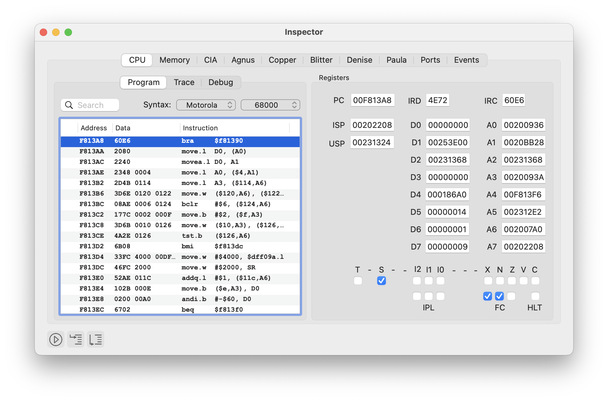

# Using the Disassembler

## Running the Disassembler 

Moira includes a built-in disassembler that converts instructions, the program counter, and the status register into human-readable text. The following API functions generate textual representations:

- `int disassemble(char *str, u32 addr) const`

   Disassembles the instruction at the specified address. The caller must ensure that the target string is initialized and large enough to hold the output. The function returns how many bytes the disassembled instruction occupies in memory, making it easy to know where the next instruction starts.

- `std::string disassemble(const std::string &fmt, u32 addr, int *len = nullptr) const`

    Disassembles the instruction at the specified address according to a format string. The following directives are supported:

    | Directive | Output |
    |-----------|--------|
    | `%p`      | Instruction address |
    | `%b`      | Instruction words |
    | `%i`      | Instruction |
    | `%f`      | Status register flags |
    | `%Nd`     | Data register DN (N = 0 ... 7) |
    | `%Na`     | Address register AN (N = 0 ... 7) |

    A number in front of `%p`, `%b`, `%i`, or `%f` pads the output with spaces to the given width. Other characters are copied to the output. If `len` is given, it receives the instruction length in bytes. An invalid format string throws `std::runtime_error`.

- `std::string Debugger::disassembleRecorded(const std::string &fmt, int nr, int *len = nullptr) const`

    Works like the function above, but disassembles an entry of the instruction log buffer and prints the register values recorded at that time.

The debugger builds on these functions: `Debugger::dumpLogBuffer` prints the log buffer, and `Debugger::disassembleRange` disassembles a range of memory and marks the current instruction and breakpoints. Both accept an optional format string.

    
## Customizing Output

The disassembler output can be customized in various ways by calling one of the following API functions:

- `void setDasmSyntax(Syntax value)` 

    Moira supports the following syntax styles: 
    - `MOIRA` (default)
        Standard Motorola syntax.
    - `MOIRA_MIT` 
        A Moira-specific variation using MIT syntax.
    - `GNU`
        Mimics the output of the m68k disassembler in `binutils`.
    - `GNU_MIT`
        Mimics the output of `binutils` when run in MIT mode. 
    - `MUSASHI`
        Reproduces the exact output of the Musashi disassembler.

- `void setDasmNumberFormat(DasmNumberFormat value)`

    Controls the formatting of numbers in disassembly output. The structure below defines the configurable parameters:

    ````c++
    struct DasmNumberFormat
    {
        const char *prefix;         // Prefix for hexidecimal numbers
        u8 radix;                   // 10 (decimal) or 16 (hexadecimal)
        bool upperCase;             // Lettercase for hexadecimal digits A...F
        bool plainZero;             // Determines whether 0 is printed with a prefix
    };
    ````

- `void setDasmLetterCase(LetterCase value)`

    The letter case determines the appearance of mnemonics and register names. The following options are availabe: 
    - `MIXED_CASE`
        Uses default case based on the selected syntax style.
    - `LOWER_CASE`
        Outputs mnemonics and register names in lowercase.
    - `UPPER_CASE`
        Outputs mnemonics and register names in uppercase.
    
- `void setDasmIndentation(int value)`

    Adjusts the spacing between the mnemonic and the rest of the instruction for better readability.

- `void setDataNumberFormat(DasmNumberFormat value)` and `void setDataIndentation(int value)`

    Configure how addresses (`%p`), instruction words (`%b`) and registers (`%Nd`, `%Na`) are printed by the format-string disassembler.

Each setter has a matching getter (`getDasmSyntax`, `getDasmNumberFormat`, `getDasmLetterCase`, `getDasmIndentation`, `getDataNumberFormat`, `getDataIndentation`).

## Examples

- Running Moira in vAmiga with syntax style `MOIRA`
    

- Running Moira in vAmiga with syntax style `MOIRA_MIT`
    

