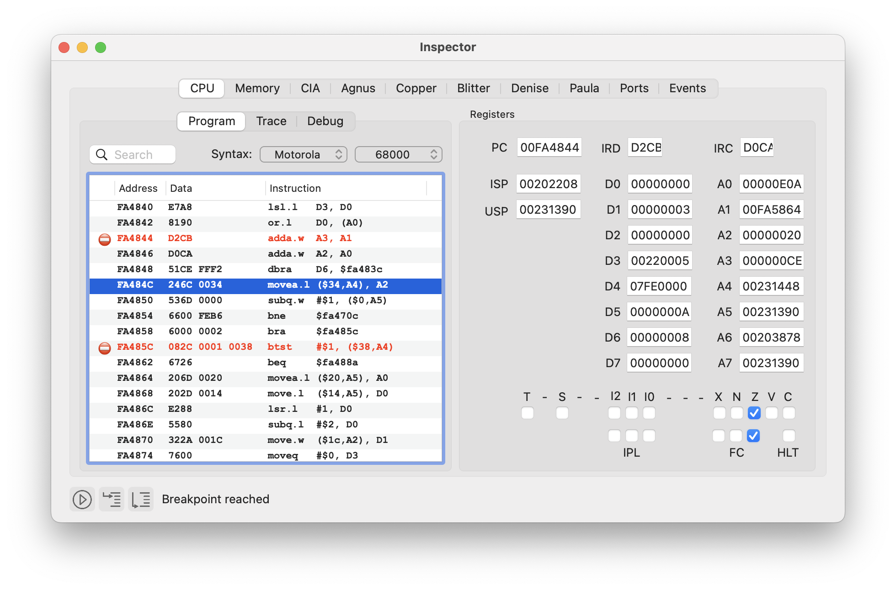

# About

Moira is an emulator of the Motorola 68000, 68010, 68EC020, 68020, 68030 and 68040, including the 68881 and 68882 floating-point coprocessors. It is compatible with macOS, Linux, and Windows. The core emulator's source code is written in C++ and published under the MIT license. Moira serves as the heart of [vAmiga](https://dirkwhoffmann.github.io/vAmiga), a high-precision emulator for the Commodore Amiga.

## Design Goals 

Moira was developed with three primary goals:

- **Accuracy**

Moira aims for high emulation accuracy, both functionally and temporally. Designed specifically with Amiga emulation in mind, it not only provides precise cycle counts but also ensures that memory accesses occur at the correct DMA cycles.

- **Efficiency**

Moira is optimized for high emulation performance. Written entirely in C++, it makes extensive use of templates to achieve high execution speed. It outperforms Musashi, one of the fastest M68k emulators available.

- **Portability**

Moira is compatible with all major C++ compilers, including Clang, GCC, and MSVC, and builds on macOS, Linux, and Windows. It also supports WebAssembly, making it suitable for web-based applications.
  
## History

Before starting the vAmiga project in early 2019, I surveyed existing Motorola 68k emulators. I was looking for a well-tested implementation that combined high performance with clean code. My search led me to Musashi, written by Karl Stenerud, which had been successfully used in the MAME project for many years.

I integrated Musashi into vAmiga and used it for about a year before discovering that it lacked a crucial feature: precise inter-instruction timing. To emulate the Amiga's memory bus accurately, I needed detailed timing information — in particular, the exact number of cycles elapsed between key events such as instruction execution and memory accesses. Like most 68k emulators, Musashi only reports the total execution time of each instruction, which was insufficient for my purposes. Since cycle-exact bus timing is essential for accurate Amiga emulation, I concluded that a more sophisticated approach to timing was needed to take vAmiga to the next level.

My search for an alternative CPU core led me to Portable68000 and its successor, Denise m680x0, both written by "PiCiJi". These emulators provided exactly what I was looking for: inter-instruction timing. However, Denise was still in its early stages at the time. Although architecturally more advanced than Portable68000, it had not yet undergone extensive testing.

At that point, I decided to implement my own CPU emulator, drawing inspiration from the three cores I had studied. In many ways, Musashi, Portable68000, and Denise m680x0 can be considered the intellectual ancestors of Moira. Externally, early versions of Moira closely resembled Musashi, even reproducing its disassembler output down to the last character. Internally, however, Moira shares many design principles with Denise m680x0. For example, it uses the same synchronization mechanism found in Portable68000 and Denise to track cycle timing between memory accesses.

## Credits

*Nanos gigantum humeris insidentes.* I am grateful to
- Karl Stenerud for writing [Musashi](https://github.com/kstenerud/Musashi), 
- PiCiJi for writing Denise [m680x0](https://bitbucket.org/piciji/denise/src/master/emulation/processor) and [portable68000](https://sourceforge.net/projects/portable68000), and
- Toni Wilen for writing [cputester](https://eab.abime.net/showthread.php?t=98747).
